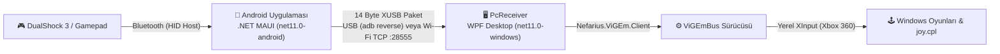

<div align="center">

# 🎮 AndroidToGamepad

### DualShock 3 / Android Gamepad → Sanal Xbox 360 Kontrolcüsü Köprüsü

[](https://dotnet.microsoft.com/)
[](androidtogamepad/androidtogamepad/androidtogamepad.csproj)
[](PcReceiver/PcReceiver.csproj)
[](https://github.com/nefarius/ViGEmBus)
[](LICENSE)

<br />

**Android telefonunuza Bluetooth (veya USB) ile bağlı bir PS3 DualShock 3 kolunun tüm tuş ve analog girdilerini, root gerektirmeden USB (`adb reverse`) veya Wi-Fi üzerinden Windows bilgisayarınıza aktarıp gerçek bir XInput (Xbox 360) oyun kumandası olarak çalıştıran açık kaynaklı düşük gecikmeli köprü.**

<br />

[✨ Özellikler](#ozellikler) •
[🏗️ Mimari](#mimari) •
[🚀 Kurulum](#kurulum) •
[🕹️ Kullanım](#kullanim) •
[📡 Ağ Protokolü](#protokol) •
[🎮 Tuş Haritalama](#haritalama) •
[🛠️ Sorun Giderme](#sorun-giderme)

</div>

---

## 🎯 Neden Bu Proje?

Windows üzerinde **DualShock 3** veya standart Android uyumlu oyun kollarını doğrudan **XInput** (Xbox 360) olarak kullanmak her zaman kolay değildir. Telefonun Bluetooth üzerinden doğrudan PC'ye HID Device gibi tanıtılması ise root'suz Android cihazlarda sistemin aynı anda hem **HID Host** (kolu dinleme) hem **HID Device** (PC'ye kol olma) rolünü yürütememesi ve `BluetoothHidDevice` API'sinde Microsoft VID/PID yazılamaması nedeniyle kısıtlıdır.

**AndroidToGamepad** bu engeli temiz bir iki parçalı mimariyle çözer:
1. **Android Uygulaması (`.NET MAUI`)**: DualShock 3'ü telefon üzerinden normal şekilde dinler, telefon arayüzüne sızan tüm kol olaylarını yutar ve **14 baytlık** ultra hafif paketleri `TCP_NODELAY` ile PC'ye aktarır.
2. **PC Alıcısı (`WPF` + `ViGEmBus`)**: Gelen paketleri anlık olarak **sanal bir Xbox 360 kontrolcüsüne** dönüştürür ve koyu temalı **60 FPS canlı görselleştirici** üzerinde gösterir. Böylece yalnızca XInput destekleyen oyunlar bile kolu yerel bir Xbox 360 kontrolcüsü olarak algılar.

---

<a id="ozellikler"></a>

## ✨ Özellikler

<table>
<tr>
<td width="50%" valign="top">

### 📱 Android Köprü Uygulaması
- **Tak-Çalıştır Girdi Yakalama:** Bluetooth veya USB ile Android'e bağlı `Gamepad` / `Joystick` kaynaklı tüm tuş ve analog olaylarını okur.
- **Sıfır Telefon Etkileşimi:** Koldan gelen tüm `KeyEvent` ve `MotionEvent` olaylarını tüketir (`return true`); kol tuşları telefon menüsünde odak kaydırmaz veya Geri işlemini tetiklemez.
- **Ekran Sabitleme (`LockTask`):** Android sisteminin `PS / Home` tuşuna basıldığında ana ekrana atmasını engellemek için tek dokunuşla ekran sabitleme desteği sunar.
- **OLED Oyun Modu:** Ekranı `%1` parlaklığa çekip simsiyah bir OLED katmanıyla kapatır (çıkmak için ekrana çift dokunun). Böylece pil tasarrufu sağlarken analog eksen akışını korur.
- **Arka Plan Dayanıklılığı:** `ForegroundService` (`TypeDataSync`) + `PartialWakeLock` + kalıcı bildirim (**Durdur** aksiyonlu) ile TCP bağlantısını canlı tutar.
- **Otomatik Yeniden Bağlanma:** Kopma durumunda her `1` saniyede bir yeniden bağlanır ve `NoDelay = true` ile en güncel durumu gecikmesiz gönderir.

</td>
<td width="50%" valign="top">

### 🖥️ PC Receiver (WPF Masaüstü)
- **Modern Koyu Arayüz:** Özel `WindowChrome` başlık çubuğu, OLED/Xbox koyu tema paleti (`#0D1117` / `#161B22`) ve zümrüt yeşili (`#22C55E`) durum göstergeleri.
- **60 FPS Canlı Kontrolcü Önizleme:** Sol/sağ analog hareketleri, `L3/R3` tıklama halkaları, `LT/RT` analog doluluk barları (`%`), `LB/RB`, 4 yönlü D-Pad, `View/Guide/Menu` ve renkli `A/B/X/Y` tuşları gerçek zamanlı animasyonla izlenir.
- **Gerçek XInput Çıkışı (`ViGEmBus`):** `Nefarius.ViGEm.Client` üzerinden `AutoSubmitReport = false` + anlık `SubmitReport()` ile sanal Xbox 360 kolu oluşturur.
- **Tek Tıkla Araçlar:**
  - **USB (ADB) Bağla:** Uygulama içinden `adb reverse tcp:<port> tcp:<port>` tünelini tek tıkla kurar.
  - **joy.cpl Aç:** Windows Oyun Denetleyicileri test aracını doğrudan açar.
  - **Kopyalanabilir IP Etiketleri:** `127.0.0.1` ve yerel Wi-Fi IPv4 adreslerini tek tıkla panoya kopyalar.
- **Canlı Telemetri & Olay Günlüğü:** Anlık paket hızı (`Hz`), toplam paket sayacı, normalize analog eksen değerleri ve zaman damgalı log ekranı.

</td>
</tr>
</table>

---

<a id="mimari"></a>

## 🏗️ Mimari ve Çalışma Mantığı



> [!IMPORTANT]
> **Android Analog Eksen Kısıtlaması Hakkında:** Root yetkisi olmayan Android cihazlarda işletim sistemi analog çubuk ve tetik (`MotionEvent`) verilerini yalnızca **ekrandaki odaklı (ön plan) aktiviteye** gönderir. Arka plan servisi (`GamepadBridgeService`) TCP bağlantısını açık tutsa da oyun sırasında uygulamanın ekranda kalması gerekir. Bu nedenle telefonunuzun ekranını korumak ve pil tüketimini en aza indirmek için uygulamadaki **Oyun Modu (Ekranı Karart)** özelliğini kullanmanız önerilir.

---

## 📁 Proje Yapısı

```text
androidtogamepad/
├── .editorconfig
├── .gitattributes
├── .gitignore
├── LICENSE
├── README.md
│
├── PcReceiver/                              # Windows WPF alıcı uygulaması (net11.0-windows)
│   ├── Models/
│   │   └── GamepadSnapshot.cs               # 14 baytlık paket snapshot modeli & XUSB bayrakları
│   ├── Services/
│   │   └── ReceiverEngine.cs                # Asenkron TCP sunucusu, ViGEm kontrolcüsü & ADB tüneli
│   ├── App.xaml / App.xaml.cs               # Koyu tema fırçaları ve özel kontrol stilleri
│   ├── MainWindow.xaml / MainWindow.xaml.cs # 60 FPS canlı Xbox 360 görselleştirici & telemetri
│   ├── PcReceiver.csproj                    # WPF proje dosyası (Nefarius.ViGEm.Client 1.21.256)
│   ├── baslat-usb.bat                       # ADB reverse + Release başlatıcı
│   └── baslat-wifi.bat                      # Wi-Fi modu için Release başlatıcı
│
└── androidtogamepad/                        # .NET MAUI çözümü
    ├── androidtogamepad.slnx
    └── androidtogamepad/
        ├── Platforms/Android/
        │   ├── Hid/
        │   │   ├── XboxButton.cs            # XInput (XUSB) buton bitmask enum'ı
        │   │   └── XboxGamepadState.cs      # Normalizasyon ve 14 baytlık ToPacket() serileştirici
        │   ├── Input/
        │   │   └── Ps3InputMapper.cs        # KeyEvent/MotionEvent → Xbox eşleme & deadzone
        │   ├── Net/
        │   │   └── PcLink.cs                # NoDelay TCP istemcisi & otomatik yeniden bağlanma
        │   ├── Services/
        │   │   └── GamepadBridgeService.cs  # Foreground Service + WakeLock + Bildirim kontrolü
        │   ├── AndroidManifest.xml          # Ağ, Foreground Service, WakeLock & Bildirim izinleri
        │   └── MainActivity.cs              # Girdi yakalama/yutma, LockTask & parlaklık kontrolü
        ├── MainPage.xaml / MainPage.xaml.cs # Bağlantı, Sabitleme, Oyun Modu & canlı hex paket UI
        └── androidtogamepad.csproj          # .NET 11 MAUI projesi (Android API 24+)
```

---

<a id="kurulum"></a>

## 🚀 Kurulum

### 1. Gereksinimler

| Bileşen | Gereken Sürüm / Araç | Açıklama |
|---|---|---|
| **.NET SDK** | `.NET 11 SDK` (`11.0.100+`) | Hem `PcReceiver` hem de MAUI uygulaması için |
| **MAUI İş Yükü** | `dotnet workload install maui-android` | Android APK derlemesi için |
| **ViGEmBus Sürücüsü** | [ViGEmBus Releases](https://github.com/nefarius/ViGEmBus/releases) | Windows'ta sanal Xbox 360 kontrolcüsü oluşturmak için **zorunlu** |
| **Android Platform Tools** *(USB için)* | `adb` (`PATH`'e ekli) | USB üzerinden düşük gecikmeli `adb reverse` tüneli için |
| **Android Cihaz** | Android `7.0` (`API 24`) ve üzeri | Ön plan servisi/bildirim özellikleri Android 8+/13+ ile tam uyumludur |

### 2. PC Alıcısını (`PcReceiver`) Çalıştırma

Önce [ViGEmBus Releases](https://github.com/nefarius/ViGEmBus/releases) sayfasından **ViGEmBus** sürücüsünü bilgisayarınıza kurun. Ardından:

```powershell
# Projeyi doğrudan Release modunda derleyip başlatmak için:
dotnet run --project PcReceiver\PcReceiver.csproj -c Release
```

Veya hazır başlatıcıları kullanabilirsiniz:
- **USB Modu:** [PcReceiver/baslat-usb.bat](PcReceiver/baslat-usb.bat) *(önce `adb reverse tcp:28555 tcp:28555` çalıştırır, ardından uygulamayı açar)*
- **Wi-Fi Modu:** [PcReceiver/baslat-wifi.bat](PcReceiver/baslat-wifi.bat)

### 3. Android Uygulamasını Derleme ve Yükleme

```powershell
# Android workload kurulu değilse:
dotnet workload install maui-android

# Release APK derleme ve bağlı cihaza kurma (USB hata ayıklama açıkken):
dotnet build androidtogamepad\androidtogamepad\androidtogamepad.csproj -f net11.0-android -c Release -t:Install
```

> [!TIP]
> Visual Studio 2026 / 2022 kullanıyorsanız `androidtogamepad\androidtogamepad.slnx` çözümünü açıp hedef cihaz olarak Android telefonunuzu seçerek de doğrudan dağıtabilirsiniz.

---

<a id="kullanim"></a>

## 🕹️ Kullanım

### Senaryo A: USB Kablo ile En Düşük Gecikme (`adb reverse`)

1. Telefonda **USB Hata Ayıklama**yı açın (*Ayarlar → Telefon hakkında → Yapı numarasına 7 kez dokunun → Geliştirici seçenekleri → USB hata ayıklama*).
2. Telefonu USB kablosuyla PC'ye bağlayın ve ekranda çıkan RSA hata ayıklama onayını kabul edin.
3. DualShock 3 (veya Android uyumlu kolunuzu) telefonunuza Bluetooth ile bağlayın.
4. PC'de **PcReceiver**'ı açın ve **"USB (ADB) Bağla"** butonuna basın *(veya `baslat-usb.bat` ile açın)*.
5. Telefondaki uygulamada IP alanına `127.0.0.1`, Port alanına `28555` yazıp **Bağlan**'a dokunun.
6. Telefon arayüzünde **Ekranı Sabitle (PS/Home Engelle)** ve ardından **Oyun Modu (Ekranı Karart)** butonlarına basarak konforlu şekilde oynamaya başlayın.
7. PC uygulamasındaki **"joy.cpl Aç"** butonuyla tüm tuş ve eksenleri doğrulayın.

### Senaryo B: Kablosuz Wi-Fi Üzerinden

1. Telefon ve PC'nin **aynı yerel ağda (Wi-Fi)** olduğundan emin olun.
2. PC'de **PcReceiver**'ı açın ve **"Bağlantı Adresleri"** kartında listelenen `Wi-Fi: 192.168.x.x` adresine bakın.
3. Telefondaki uygulamada bu yerel IP adresini ve `28555` portunu girerek **Bağlan**'a dokunun.
4. Windows Güvenlik Duvarı uyarı verirse yerel ağ erişimine izin verin.

---

<a id="protokol"></a>

## 📡 14 Baytlık TCP Protokolü

Telefon ve PC arasındaki veri aktarımı `Little-Endian` düzeninde sabit **14 baytlık** ikili çerçevelerle yapılır (`XboxGamepadState.ToPacket()` → `ReceiverEngine.AcceptLoopAsync()`):

| Bayt Aralığı | Veri Tipi | Alan | Değer Aralığı ve Açıklama |
| :---: | :---: | :--- | :--- |
| `0` | `byte` | **Magic** | Sabit paket başlığı `0xA5` |
| `1` | `byte` | **Version** | Protokol sürümü `0x01` |
| `2..3` | `ushort` *(LE)* | **Buttons** | XUSB bitmask bayrakları (`XboxButton`) |
| `4` | `byte` | **LT** | Sol tetik `0..255` (`L2` analog veya dijital yedek `255`) |
| `5` | `byte` | **RT** | Sağ tetik `0..255` (`R2` analog veya dijital yedek `255`) |
| `6..7` | `short` *(LE)* | **LX** | Sol analog X (`-32768..32767`) |
| `8..9` | `short` *(LE)* | **LY** | Sol analog Y (`-32768..32767`, yukarı pozitif; Android Y ekseni terslenir) |
| `10..11` | `short` *(LE)* | **RX** | Sağ analog X (`-32768..32767`) |
| `12..13` | `short` *(LE)* | **RY** | Sağ analog Y (`-32768..32767`, yukarı pozitif; Android Y ekseni terslenir) |

<details>
<summary><b>XUSB Buton Bitmask Değerleri (Bayt 2..3)</b></summary>

| Bitmask (`Hex`) | XUSB / `XboxButton` Adı |
| :---: | :--- |
| `0x0001` | `DpadUp` |
| `0x0002` | `DpadDown` |
| `0x0004` | `DpadLeft` |
| `0x0008` | `DpadRight` |
| `0x0010` | `Menu` (`Start`) |
| `0x0020` | `View` (`Back`) |
| `0x0040` | `LS` (`LeftThumb`) |
| `0x0080` | `RS` (`RightThumb`) |
| `0x0100` | `LB` (`LeftShoulder`) |
| `0x0200` | `RB` (`RightShoulder`) |
| `0x0400` | `Guide` (`Xbox / PS`) |
| `0x1000` | `A` |
| `0x2000` | `B` |
| `0x4000` | `X` |
| `0x8000` | `Y` |

</details>

---

<a id="haritalama"></a>

## 🎮 PS3 → Xbox 360 Girdi Haritalama

`Ps3InputMapper` sınıfı yalnızca `InputSourceType.Gamepad` veya `InputSourceType.Joystick` kaynaklı cihazlardan gelen olayları işler ve cihazın kendi `Flat` ölü bölgesini (minimum `0.05`) otomatik uygular:

| DualShock 3 / Android Girdisi | Android `Keycode` / `Axis` | Xbox 360 Hedefi |
| :--- | :--- | :--- |
| **✕ (Cross)** | `Keycode.ButtonA` | **A** |
| **◯ (Circle)** | `Keycode.ButtonB` | **B** |
| **□ (Square)** | `Keycode.ButtonX` | **X** |
| **△ (Triangle)** | `Keycode.ButtonY` | **Y** |
| **L1 / R1** | `Keycode.ButtonL1` / `ButtonR1` | **LB / RB** |
| **L2 / R2** | `Axis.Ltrigger` (`Brake`) / `Rtrigger` (`Gas`) *(veya dijital `ButtonL2`/`R2`)* | **LT / RT** (`0–255`) |
| **L3 / R3** | `Keycode.ButtonThumbl` / `ButtonThumbr` | **LS / RS** |
| **Select / Start** | `Keycode.ButtonSelect` (`Back`) / `Keycode.ButtonStart` | **View / Menu** |
| **PS Tuşu** | `Keycode.ButtonMode` / `Keycode.Home` | **Xbox Guide** |
| **D-Pad** | `Keycode.Dpad*` veya `Axis.HatX` / `HatY` | **D-Pad (8 Yön)** |
| **Sol Analog** | `Axis.X` / `Axis.Y` | **Left Thumb (X / Y)** |
| **Sağ Analog** | `Axis.Z` / `Axis.Rz` *(yoksa `Axis.Rx` / `Axis.Ry`)* | **Right Thumb (X / Y)** |

---

<a id="sorun-giderme"></a>

## 🛠️ Sorun Giderme

<details>
<summary><b>❌ "ViGEmBus Sürücüsü Eksik" uyarısı alıyorum</b></summary>

PC uygulaması sanal Xbox 360 kolu oluşturabilmek için kernel seviyesinde **ViGEmBus** sürücüsüne ihtiyaç duyar. [ViGEmBus Releases](https://github.com/nefarius/ViGEmBus/releases) sayfasından güncel yükleyiciyi kurup PcReceiver'ı yeniden başlatın (uygulamadaki **ViGEmBus İndir** butonu doğrudan bu sayfayı açar).

</details>

<details>
<summary><b>🔌 "adb bulunamadı" hatası alıyorum (USB Modu)</b></summary>

Android **Platform Tools** (`adb.exe`) sistem `PATH` değişkeninde tanımlı değilse `adb reverse` çalışmaz. Platform Tools'u indirip `PATH`'e ekleyin ya da alternatif olarak Wi-Fi modunda PC'nin yerel IP adresiyle bağlanın.

</details>

<details>
<summary><b>🏠 PS / Home tuşuna basınca telefon ana ekrana dönüyor</b></summary>

Bazı Android sürümlerinde sistem pencere yöneticisi (`PhoneWindowManager`) Home tuşunu uygulamaya hiç göndermeden yakalayabilir. Oynamaya başlamadan önce uygulamadaki **"Ekranı Sabitle (PS/Home Engelle)"** butonuna basın; sistem düzeyinde ekran sabitleme aktifken Home / Son Uygulamalar tuşları kilitlenir. *(Cihaz ayarlarında "Ekran sabitleme" özelliği kapalıysa önce Ayarlar → Güvenlik altından etkinleştirin.)*

</details>

<details>
<summary><b>🕹️ Uygulamayı alta alınca analog çubuklar çalışmayı durduruyor</b></summary>

Bu Android işletim sisteminin güvenlik tasarımıdır: root olmadan `MotionEvent` (analog çubuk ve tetik) verileri arka plandaki uygulamalara iletilmez. Çözüm olarak **"Oyun Modu (Ekranı Karart)"** butonunu kullanın; uygulama ön planda kalarak tüm verileri aktarırken ekran siyah OLED modunda minimum güç tüketir.

</details>

<details>
<summary><b>📶 Wi-Fi üzerinden bağlanamıyorum</b></summary>

- Telefon ve PC'nin aynı ağda olduğundan (misafir Wi-Fi / AP izolasyonu kapalı olduğundan) emin olun.
- Windows Güvenlik Duvarı'nda TCP `28555` portuna izin verildiğini kontrol edin.
- Telefonda `127.0.0.1` yerine PcReceiver ekranında gördüğünüz `192.168.x.x` yerel IP adresini yazdığınızdan emin olun.

</details>

---

## 📄 Lisans

Bu proje [MIT Lisansı](LICENSE) altında lisanslanmıştır.
