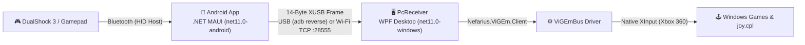

<div align="center">

# 🎮 AndroidToGamepad

### DualShock 3 / Android Gamepad → Virtual Xbox 360 Controller Bridge

[](https://dotnet.microsoft.com/)
[](androidtogamepad/androidtogamepad/androidtogamepad.csproj)
[](PcReceiver/PcReceiver.csproj)
[](https://github.com/nefarius/ViGEmBus)
[](LICENSE)

<br />

**An open-source, ultra-low-latency bridge that forwards all button and analog inputs from a PS3 DualShock 3 (or any Android-compatible gamepad) paired to your Android phone over USB (`adb reverse`) or Wi-Fi to Windows, emulating a native XInput Xbox 360 controller with zero root access required.**

<br />

[✨ Features](#features) •
[🏗️ Architecture](#architecture) •
[🚀 Setup](#setup) •
[🕹️ Usage](#usage) •
[📡 Wire Protocol](#protocol) •
[🎮 Input Mapping](#mapping) •
[🛠️ Troubleshooting](#troubleshooting)

</div>

---

## 🎯 Why This Project?

Using a **DualShock 3** or Android-paired controller seamlessly as a native **XInput (Xbox 360)** pad on Windows can be tricky without dedicated hardware dongles or kernel workarounds. On non-root Android phones, acting directly as a Bluetooth HID Device proxy while simultaneously reading a Bluetooth controller fails at the OS stack level (Android cannot host both HID Host and HID Device roles reliably on the same Bluetooth stack, nor can it override Microsoft's Xbox VID/PID in SDP records).

**AndroidToGamepad** solves this cleanly with a two-part architecture:
1. **Android Bridge App (`.NET MAUI`)**: Listens to the DualShock 3 paired to the phone, swallows every gamepad event so it never leaks into the Android UI, and streams compact **14-byte** packets over `TCP_NODELAY` (`NoDelay = true`).
2. **PC Receiver (`WPF` + `ViGEmBus`)**: Receives packets on a dedicated background thread, feeds a virtual **Xbox 360 controller** via ViGEmBus, and renders a sleek dark-themed **60 FPS live controller visualizer** so even XInput-only PC games detect it natively.

---

<a id="features"></a>

## ✨ Features

<table>
<tr>
<td width="50%" valign="top">

### 📱 Android Bridge App
- **Plug-and-Play Input Capture:** Reads `Gamepad` and `Joystick` `KeyEvent` / `MotionEvent` streams from Bluetooth or USB controllers connected to Android.
- **Zero Phone Interference:** Consumes **all** events originating from gamepad devices (`return true`) so button presses never move UI focus, click buttons, or trigger Back navigation.
- **Screen Pinning (`LockTask`):** Includes a one-tap toggle (`Ekranı Sabitle`) to engage Android Screen Pinning and block OS-level `PS / Home` button interception.
- **OLED Game Mode:** Dims brightness to `1%` with a pure-black overlay (`Oyun Modu`; double-tap to exit) to preserve battery while keeping the app focused for analog stick input.
- **Background Resilience:** Runs a `ForegroundService` (`TypeDataSync`) with `PartialWakeLock` and a persistent notification (**Stop / Durdur** action) to keep the TCP bridge alive.
- **Auto-Reconnect:** Automatically retries every `1` second on disconnect while keeping UI threads completely non-blocking.

</td>
<td width="50%" valign="top">

### 🖥️ PC Receiver (WPF Desktop)
- **Modern Dark Studio UI:** Custom `WindowChrome` title bar, OLED/Xbox dark palette (`#0D1117` / `#161B22`), and emerald (`#22C55E`) status indicators.
- **60 FPS Live Controller Visualizer:** Real-time visualization of thumbstick movement (`LX/LY`, `RX/RY`), `L3/R3` click rings, `LT/RT` trigger bars (`%`), `LB/RB` bumpers, 4-way D-Pad, `View/Guide/Menu`, and colored `A/B/X/Y` buttons.
- **Native XInput Output (`ViGEmBus`):** Drives a virtual Xbox 360 gamepad via `Nefarius.ViGEm.Client` (`AutoSubmitReport = false` → immediate `SubmitReport()`).
- **One-Click Utilities:**
  - **USB (ADB) Tunnel (`USB (ADB) Bağla`):** Runs `adb reverse tcp:<port> tcp:<port>` directly from the UI.
  - **Quick `joy.cpl` Launch (`joy.cpl Aç`):** Opens Windows Game Controllers tester directly.
  - **Clickable IP Pills:** Copy `127.0.0.1` or local Wi-Fi IPv4 addresses to clipboard in one click.
- **Live Telemetry & Event Log:** Displays real-time packet rate (`Hz`), total packet count, normalized stick coordinates, and timestamped connection logs.

</td>
</tr>
</table>

---

<a id="architecture"></a>

## 🏗️ Architecture & How It Works



> [!IMPORTANT]
> **Android Analog Axis Limitation:** On non-root Android devices, the OS only dispatches `MotionEvent` data (analog sticks and triggers) to the **currently focused foreground Activity**. While the Foreground Service (`GamepadBridgeService`) keeps the TCP link alive in the background, the app should stay on screen during gameplay. Use the built-in **Oyun Modu (Game Mode)** to turn OLED pixels completely off at `1%` brightness while keeping analog axes streaming.

---

## 📁 Project Structure

```text
androidtogamepad/
├── .editorconfig
├── .gitattributes
├── .gitignore
├── LICENSE
├── README.md
│
├── PcReceiver/                              # Windows WPF receiver (net11.0-windows)
│   ├── Models/
│   │   └── GamepadSnapshot.cs               # Immutable 14-byte snapshot & XUSB button flags
│   ├── Services/
│   │   └── ReceiverEngine.cs                # Async TCP server, ViGEm controller & ADB helper
│   ├── App.xaml / App.xaml.cs               # Dark theme brushes & custom WPF control templates
│   ├── MainWindow.xaml / MainWindow.xaml.cs # 60 FPS live Xbox 360 visualizer & telemetry
│   ├── PcReceiver.csproj                    # WPF project (Nefarius.ViGEm.Client 1.21.256)
│   ├── baslat-usb.bat                       # Runs adb reverse + launches Release build
│   └── baslat-wifi.bat                      # Launches Release build for Wi-Fi mode
│
└── androidtogamepad/                        # .NET MAUI solution
    ├── androidtogamepad.slnx
    └── androidtogamepad/
        ├── Platforms/Android/
        │   ├── Hid/
        │   │   ├── XboxButton.cs            # XInput (XUSB) button bitmask enum
        │   │   └── XboxGamepadState.cs      # Axis normalization & 14-byte ToPacket() encoder
        │   ├── Input/
        │   │   └── Ps3InputMapper.cs        # KeyEvent/MotionEvent → Xbox mapping & deadzones
        │   ├── Net/
        │   │   └── PcLink.cs                # NoDelay TCP worker & automatic 1s reconnect loop
        │   ├── Services/
        │   │   └── GamepadBridgeService.cs  # Foreground Service + PartialWakeLock + Notification
        │   ├── AndroidManifest.xml          # Network, Foreground Service, WakeLock & Notification perms
        │   └── MainActivity.cs              # Input capture/swallowing, LockTask & brightness control
        ├── MainPage.xaml / MainPage.xaml.cs # Connection UI, Screen Pinning, Game Mode & hex debug
        └── androidtogamepad.csproj          # .NET 11 MAUI project (Android API 24+)
```

---

<a id="setup"></a>

## 🚀 Setup

### 1. Prerequisites

| Component | Requirement | Notes |
|---|---|---|
| **.NET SDK** | `.NET 11 SDK` (`11.0.100+`) | Required for both `PcReceiver` and the MAUI app |
| **MAUI Workload** | `dotnet workload install maui-android` | Required to build/deploy the Android APK |
| **ViGEmBus Driver** | [ViGEmBus Releases](https://github.com/nefarius/ViGEmBus/releases) | **Required** on Windows to create virtual Xbox 360 controllers |
| **Android Platform Tools** *(USB only)* | `adb` in `PATH` | Used for low-latency USB tunneling via `adb reverse` |
| **Android Device** | Android `7.0` (`API 24`) or newer | Foreground service & notification features target API 26+/33+ |

### 2. Running the PC Receiver (`PcReceiver`)

First, install **ViGEmBus** from [ViGEmBus Releases](https://github.com/nefarius/ViGEmBus/releases). Then launch `PcReceiver`:

```powershell
# Build and launch the WPF receiver in Release mode:
dotnet run --project PcReceiver\PcReceiver.csproj -c Release
```

Or use the included quick-launch scripts:
- **USB Mode:** [PcReceiver/baslat-usb.bat](PcReceiver/baslat-usb.bat) *(runs `adb reverse tcp:28555 tcp:28555` and starts the app)*
- **Wi-Fi Mode:** [PcReceiver/baslat-wifi.bat](PcReceiver/baslat-wifi.bat)

### 3. Building & Installing the Android App

```powershell
# Install the MAUI Android workload if not already installed:
dotnet workload install maui-android

# Build and install Release APK to a USB-connected Android device:
dotnet build androidtogamepad\androidtogamepad\androidtogamepad.csproj -f net11.0-android -c Release -t:Install
```

> [!TIP]
> You can also open `androidtogamepad\androidtogamepad.slnx` in Visual Studio 2026 / 2022, select your Android device as the target, and deploy directly.

---

<a id="usage"></a>

## 🕹️ Usage

> *Note: The in-app UI labels are currently in Turkish (`Bağlan` = Connect, `Bağlantıyı Kes` = Disconnect, `Ekranı Sabitle` = Pin Screen, `Oyun Modu` = Game Mode, `USB (ADB) Bağla` = Setup USB ADB, `joy.cpl Aç` = Open joy.cpl).*

### Option A: USB Cable via `adb reverse` (Lowest Latency)

1. Enable **USB Debugging** on your Android phone (*Settings → About phone → Tap Build number 7 times → Developer options → USB debugging*).
2. Connect the phone to your PC via USB and accept the RSA debugging prompt.
3. Pair/connect your DualShock 3 (or compatible gamepad) to the phone over Bluetooth.
4. Launch **PcReceiver** on Windows and click **`USB (ADB) Bağla`** *(or start via `baslat-usb.bat`)*.
5. In the Android app, enter `127.0.0.1` and port `28555`, then tap **`Bağlan`** (Connect).
6. Tap **`Ekranı Sabitle (PS/Home Engelle)`** to lock out the Home button, and **`Oyun Modu (Ekranı Karart)`** to black out the screen while playing.
7. Click **`joy.cpl Aç`** on PC to verify all buttons, triggers, and thumbsticks in Windows Game Controllers.

### Option B: Wireless over Wi-Fi

1. Ensure both your phone and Windows PC are on the **same local Wi-Fi network**.
2. Launch **PcReceiver** and check the **`Bağlantı Adresleri`** card for your PC's local IPv4 address (`Wi-Fi: 192.168.x.x`).
3. Enter that IP address and port `28555` in the Android app and tap **`Bağlan`**.
4. Allow TCP port `28555` through Windows Defender Firewall if prompted.

---

<a id="protocol"></a>

## 📡 14-Byte TCP Wire Protocol

Controller state is serialized as fixed **14-byte little-endian** frames (`XboxGamepadState.ToPacket()` → `ReceiverEngine.AcceptLoopAsync()`):

| Byte Offset | Type | Field | Range & Description |
| :---: | :---: | :--- | :--- |
| `0` | `byte` | **Magic** | Fixed header byte `0xA5` |
| `1` | `byte` | **Version** | Protocol version `0x01` |
| `2..3` | `ushort` *(LE)* | **Buttons** | XUSB bitmask flags (`XboxButton`) |
| `4` | `byte` | **LT** | Left trigger `0..255` (`L2` analog or `255` digital fallback) |
| `5` | `byte` | **RT** | Right trigger `0..255` (`R2` analog or `255` digital fallback) |
| `6..7` | `short` *(LE)* | **LX** | Left stick X (`-32768..32767`) |
| `8..9` | `short` *(LE)* | **LY** | Left stick Y (`-32768..32767`, up is positive — inverted from Android Y) |
| `10..11` | `short` *(LE)* | **RX** | Right stick X (`-32768..32767`) |
| `12..13` | `short` *(LE)* | **RY** | Right stick Y (`-32768..32767`, up is positive — inverted from Android Y) |

<details>
<summary><b>XUSB Button Bitmask Flags (Bytes 2..3)</b></summary>

| Bitmask (`Hex`) | XUSB / `XboxButton` Flag |
| :---: | :--- |
| `0x0001` | `DpadUp` |
| `0x0002` | `DpadDown` |
| `0x0004` | `DpadLeft` |
| `0x0008` | `DpadRight` |
| `0x0010` | `Menu` (`Start`) |
| `0x0020` | `View` (`Back`) |
| `0x0040` | `LS` (`LeftThumb`) |
| `0x0080` | `RS` (`RightThumb`) |
| `0x0100` | `LB` (`LeftShoulder`) |
| `0x0200` | `RB` (`RightShoulder`) |
| `0x0400` | `Guide` (`Xbox / PS`) |
| `0x1000` | `A` |
| `0x2000` | `B` |
| `0x4000` | `X` |
| `0x8000` | `Y` |

</details>

---

<a id="mapping"></a>

## 🎮 PS3 → Xbox 360 Input Mapping

`Ps3InputMapper` filters strictly for devices exposing `InputSourceType.Gamepad` or `InputSourceType.Joystick` and applies per-axis `MotionRange.Flat` deadzones (minimum `0.05`):

| DualShock 3 / Android Input | Android `Keycode` / `Axis` | Xbox 360 Target |
| :--- | :--- | :--- |
| **✕ (Cross)** | `Keycode.ButtonA` | **A** |
| **◯ (Circle)** | `Keycode.ButtonB` | **B** |
| **□ (Square)** | `Keycode.ButtonX` | **X** |
| **△ (Triangle)** | `Keycode.ButtonY` | **Y** |
| **L1 / R1** | `Keycode.ButtonL1` / `ButtonR1` | **LB / RB** |
| **L2 / R2** | `Axis.Ltrigger` (`Brake`) / `Rtrigger` (`Gas`) *(or digital `ButtonL2`/`R2`)* | **LT / RT** (`0–255`) |
| **L3 / R3** | `Keycode.ButtonThumbl` / `ButtonThumbr` | **LS / RS** |
| **Select / Start** | `Keycode.ButtonSelect` (`Back`) / `Keycode.ButtonStart` | **View / Menu** |
| **PS Button** | `Keycode.ButtonMode` / `Keycode.Home` | **Xbox Guide** |
| **D-Pad** | `Keycode.Dpad*` or `Axis.HatX` / `HatY` | **D-Pad (8-Way)** |
| **Left Stick** | `Axis.X` / `Axis.Y` | **Left Thumb (X / Y)** |
| **Right Stick** | `Axis.Z` / `Axis.Rz` *(falls back to `Axis.Rx` / `Axis.Ry`)* | **Right Thumb (X / Y)** |

---

<a id="troubleshooting"></a>

## 🛠️ Troubleshooting

<details>
<summary><b>❌ "ViGEmBus Sürücüsü Eksik" (ViGEmBus driver missing) warning</b></summary>

Windows requires the kernel-level **ViGEmBus** driver to emulate virtual Xbox 360 controllers. Download and install it from [ViGEmBus Releases](https://github.com/nefarius/ViGEmBus/releases), then restart `PcReceiver` (you can also click the **`ViGEmBus İndir`** button directly in the banner).

</details>

<details>
<summary><b>🔌 "adb bulunamadı" (adb not found) error in USB mode</b></summary>

`adb.exe` from Android **Platform Tools** must be available in your system `PATH` for `adb reverse` to work. Add Platform Tools to `PATH`, or switch to Wi-Fi mode using your PC's local IPv4 address.

</details>

<details>
<summary><b>🏠 Pressing the PS / Home button exits to the Android home screen</b></summary>

Some Android OEM builds intercept `KEYCODE_HOME` in `PhoneWindowManager` before delivering it to the foreground app. Tap **`Ekranı Sabitle (PS/Home Engelle)`** before playing to engage Android Screen Pinning and lock Home/Recents navigation at the OS level *(ensure Screen Pinning is enabled under Android Settings → Security if prompted)*.

</details>

<details>
<summary><b>🕹️ Analog sticks stop updating when minimizing the app</b></summary>

Non-root Android restricts `MotionEvent` delivery to the focused foreground Activity by design. Tap **`Oyun Modu (Ekranı Karart)`** to dim the screen to `1%` with a black OLED overlay while keeping the Activity focused and analog inputs streaming.

</details>

<details>
<summary><b>📶 Unable to connect over Wi-Fi</b></summary>

- Confirm both devices are on the same subnet (client/AP isolation disabled on router).
- Ensure Windows Firewall allows inbound TCP on port `28555`.
- Make sure you entered the PC's local IPv4 address (`192.168.x.x`) instead of `127.0.0.1`.

</details>

---

## 📄 License

This project is licensed under the [MIT License](LICENSE).
